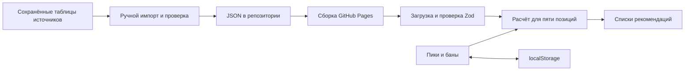

# Архитектура

## Общая схема



Во время использования приложение не обращается к Dotabuff или Dota2ProTracker. Оно читает опубликованные файлы своего сайта.

## Карта файлов

| Файл или каталог | Назначение |
| --- | --- |
| `src/main.tsx` | Запуск React и подключение стилей. |
| `src/App.tsx` | Интерфейс, состояние драфта, поиск, модалка, сохранение и миграция. |
| `src/data.ts` | Типы, схемы Zod, загрузка JSON и проверка сохранённого драфта. |
| `src/engine.ts` | Функция `recommend` и расчёт компонентов оценки. |
| `src/styles.css` | Стили, адаптация к ширине экрана и изображения героев. |
| `public/data/heroes.json` | Каталог героев, идентификаторы, поисковые имена и теги способностей. |
| `public/data/statistics.json` | Данные ролей, матчапов и сведения об источниках. |
| `public/data/statistics.schema.json` | JSON Schema, которую создаёт проверка данных. |
| `public/images/heroes/` | Локальные PNG-портреты всех героев. |
| `data-sources/` | Сохранённые исходные таблицы для воспроизводимого импорта. |
| `scripts/import-dotabuff.ts` | Преобразование сохранённых таблиц Dotabuff в статистику. |
| `scripts/validate-data.ts` | Проверка каталога, статистики и портретов; создание JSON Schema. |
| `scripts/audit-dependencies.mjs` | Проверка пакетов из lockfile по базе OSV. |
| `scripts/deploy.mjs` | Публикация содержимого `dist/` в ветку `gh-pages`. |
| `tests/engine.test.ts` | Проверки движка, схем и опубликованного набора данных. |
| `vite.config.ts`, `index.html` | Пути ресурсов и Content Security Policy. |

## Загрузка данных

`loadData()` загружает каталог и статистику параллельно с параметром `cache: 'no-cache'`. Адреса строятся относительно базы приложения.

Zod проверяет структуру файлов. Дополнительная проверка отклоняет неизвестные идентификаторы героев в статистике. Повторы записей также запрещены.

После загрузки приложение восстанавливает драфт. Затем оно разрешает изменение слотов и сохраняет последующие изменения.

При ошибке загрузки интерфейс показывает сообщение и кнопку повторной загрузки. При `isDemo: true` интерфейс не показывает рекомендации.

## Состояние драфта

```ts
{
  allies: [number | null, number | null, number | null, number | null, number | null],
  enemies: [number | null, number | null, number | null, number | null, number | null],
  bans: number[]
}
```

Массивы содержат идентификаторы героев. `null` означает пустой слот. Один герой не может одновременно находиться в нескольких слотах или банах.

Порядок `allies`: `carry`, `mid`, `offlane`, `support`, `hard-support`. Для `enemies` порядок не несёт информации о позиции.

Текущее сохранение использует ключ `draft-assistant-v3` и объект `{ version: 3, draft }`. Хранение относится к браузеру и адресу сайта.

При отсутствии подходящего v3 приложение пробует `draft-assistant-v2`. Из старой записи переносится только драфт. Ранг и роль пользователя больше не используются.

Неизвестные герои и некорректные сохранения не восстанавливаются. Ошибка доступа к localStorage не блокирует работу приложения.

## Контракт движка

```ts
recommend(heroes, statistics, draft, role, rank): Recommendation[]
```

Интерфейс вызывает функцию для пяти ролей с `rank: 'all'`. Результаты каждой роли независимы. Они не являются пятью готовыми совместными составами команды.

Функция возвращает до пяти кандидатов. Она исключает все пики и баны. Если слот оцениваемой позиции занят, его герой остаётся недоступным кандидатом.

Занятый оцениваемый слот не учитывается как дополнительный союзник. Остальные союзники учитываются с известными позициями.

`Recommendation` содержит героя, оценку, выборку, компоненты расчёта и диагностические строки. Интерфейс показывает только имя, портрет и место в списке.

`score` служит для сортировки. Это не вероятность победы. Формула и пороги описаны в [руководстве по данным](data.md).

Индекс скорректированных матчапов хранится в `WeakMap` по объекту статистики. При изменении статистики создавайте новый объект. Изменение существующего объекта может оставить индекс устаревшим.

## Поведение интерфейса

Поиск работает по имени и псевдонимам без учёта регистра. До ввода строки список героев скрыт. Выбранные герои видны как недоступные результаты.

Модалка использует `<dialog>`. После открытия фокус переходит в поиск. Enter выбирает первого доступного героя из результатов.

При ширине до 760 px включаются табы позиций и нижняя панель поиска. Скрытые списки рекомендаций не должны занимать место.

Портреты загружаются с сайта приложения. Они имеют пропорции 16:9. Не заменяйте их квадратными контейнерами с обрезкой.

## Границы системы

Движок работает синхронно в браузере. Сейчас нет обучения на результатах матчей, сервиса обновления данных или автоматической проверки свежести патча.

Production использует ограничительную CSP. Vite убирает эту meta-политику только при разработке для работы обновления модулей.

GitHub Pages управляет HTTP-заголовками. Текущая конфигурация проекта не задаёт собственные серверные заголовки.
